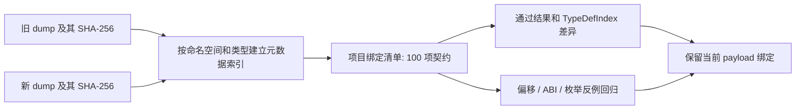

# 2026-10-08 dump 静态兼容性核对

## 结果

`Observed`：已检查的 100 项元数据契约全部通过。现有 payload 的公开类型名、方法参数签名、按名/按类型字段解析、固定偏移和枚举值映射均没有发现需要替换的更新项，因此本次没有修改 payload 绑定代码。

该结果来自两份 `dump.cs` 的静态比较。它没有执行游戏、安装 Hook，也没有验证混淆字段的原生读写语义；游戏内显示与 Hook 触发仍须以运行结果为准。

## 输入与来源

| 输入 | 大小 | SHA-256 |
| --- | ---: | --- |
| 原工作区 `F:\ToolsBOX\dump.cs` | 55,529,423 字节 | `eb07f3d16e203f90a161b461b1a798ac99da50cc86dba5c189f897bf409531b9` |
| `F:\恐鬼症外挂定制\最新dump.cs` | 55,988,347 字节 | `790eb6d6e72fa3641631ec1cf21dc5671327124b1be174e6f192be0626929003` |

详细输入来源、每项前后值、检查结果与索引变化记录在 [JSON 证据](game-update-audit-2026-10-08.json)。更新根目录 dump 后，旧版本保存在 `F:\ToolsBOX\out\update-2026-10-08\dump.previous.cs` 供再次比较。

## 检查覆盖

| 检查类别 | 数量 | 结果 |
| --- | ---: | --- |
| 游戏类型的字段布局 | 25 | 全部一致 |
| 运行时方法绑定签名 | 30 | 全部存在且签名一致 |
| 按字段名解析 | 14 | 名称、类型与偏移一致 |
| 按字段类型解析 | 15 | 数量与偏移一致 |
| 固定及后备字段偏移 | 10 | 预期位置存在对应类型 |
| Photon 值类型 ABI 布局 | 2 | 全部一致 |
| 被显示逻辑使用的枚举值 | 4 | 名称及值映射一致 |

字段布局比较会将非 ASCII 混淆标识符归一化，保留字段类型结构、可见名称、偏移和静态属性。方法签名比较忽略参数变量名，保留返回值、参数类型、参数数量和静态属性。

25 个游戏类型：`GhostAI`、`LevelController`、`PCPropGrab`、`Network`、`Network.PlayerSpot`、`Player`、`LocalPlayer`、`NetworkedHeadMountedSocket`、`PlayerSanity`、`Difficulty`、`GameController`、`LevelStats`、`Crucifix`、`WhiteSage`、`OuijaBoard`、`Equipment`、`StoreItem`、`PhotonObjectInteract`、`Prop`、`PCCanvas`、`LightSwitch`、`Door`、`Drawer`、`PlayerStamina`、`LevelValues`。

## 关键兼容性证据

### Hook 与游戏调用

| 类型与方法 | 新 dump 中的签名 |
| --- | --- |
| `PCPropGrab.Update` | `void ()` |
| `PlayerSanity.Update` | `void ()` |
| `GhostAI.Hunting` | `void (bool, int, PhotonMessageInfo)` |
| `Crucifix.CrucifixUseNetworked` | `void (bool, PhotonMessageInfo)` |
| `WhiteSage.UseNetworked` | `void (bool, PhotonMessageInfo)` |
| `OuijaBoard.PlayMessageSequence` | `void (string, PhotonMessageInfo)` |
| `Photon.Realtime.LoadBalancingClient.OnEvent` | `void (EventData)` |

`PhotonMessageInfo` 的 `timeInt/Sender/photonView` 字段仍位于 `0x0/0x8/0x10`，对应现有 x64 24 字节结构；`SendOptions` 布局也保持一致。其他检查覆盖单例 getter、Unity Transform/Camera/NavMeshAgent 调用和 Photon 同步 API。

### 固定与后备偏移

| 读取用途 | 新 dump 偏移/类型 |
| --- | --- |
| 鬼魂状态 | `GhostAI + 0x30`，状态枚举 |
| 猎杀标志 | `GhostAI + 0xF3`，`bool` |
| 玩家死亡标志 | `Player + 0x28`，`bool` |
| 玩家头部目标 | `Player + 0x88`，`Transform` |
| 玩家列表 | `Network + 0x38`，`List<Network.PlayerSpot>` |
| 当前难度 | `LevelValues + 0x38`，`Difficulty` |
| 当前 insanity | `PlayerSanity + 0x30`，`float` |
| 当前体力 | `PlayerStamina + 0x40`，`float` |
| 交互状态后备值 | `PCCanvas + 0x88`，交互枚举 |
| 物品列表后备值 | `PCPropGrab + 0x50`，`List<PhotonObjectInteract>` |

`GhostAI` 状态 `hunting=2`、`PCCanvas` 交互状态、21 项 `StoreItem.equipmentType` 和装备等级枚举保持一致。

### 类型索引与混淆变化

`Observed`：所检查类型中 16 个 `TypeDefIndex` 改变，例如 `PCPropGrab 1228→1230`、`Player 1268→1270`、`PlayerSanity 1324→1326`。大量混淆字段名和方法名也发生变化。

`Inferred`：这些索引/混淆名称变化不直接破坏当前绑定，因为 payload 使用 IL2CPP 的 namespace/class/method API、字段类型或未混淆字段名解析，不以 `TypeDefIndex` 或固定方法 RVA 定位。未发现需要将旧 RVA 批量替换为新 RVA 的代码路径。

## 复现

检查器只使用 Python 标准库，读取输入；只有指定 `--output` 时写入报告。

```powershell
python F:\ToolsBOX\tools\dump_compatibility.py `
  F:\ToolsBOX\out\update-2026-10-08\dump.previous.cs `
  F:\恐鬼症外挂定制\最新dump.cs `
  --output F:\ToolsBOX\out\update-2026-10-08\dump-check.json

python F:\ToolsBOX\tools\test_dump_compatibility.py `
  F:\ToolsBOX\out\update-2026-10-08\dump.previous.cs `
  F:\恐鬼症外挂定制\最新dump.cs
```

实际结果：`100/100 metadata checks passed`；5 项检查器回归测试通过。

- 偏移 `0xF3` 漂移：同时检出类布局变化和固定偏移失配。
- Hook `Hunting` 首参数 `bool→int`：检出签名变化。
- 状态枚举 `hunting=2→999`：检出枚举值变化。
- 对修改签名的完整 dump，CLI 输出 `99/100` 并返回退出码 `1`。
- 非法输入返回退出码 `2`；正常检查返回 `0`。

测试过程还发现并修复了检查器最初对 CRLF 类型头解析失败的问题；当前读取同时支持原始 LF dump 和 Windows 写出的 CRLF dump。



## 未决项

运行时 IL2CPP 导出可用性、真实字段语义、Hook 实际触发和各显示功能的游戏内行为不在 dump 静态比较的证明范围内。嵌入式启动与构建产物的验证见本次主更新报告。
