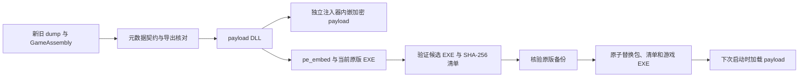

# Phasmophobia 更新核对与嵌入部署 — 2026-10-08

## 结果

- 已针对本机 Steam build **25777209** 核对用户提供的最新 dump 与游戏程序集。
- **100/100** 元数据契约通过，payload 所需 **20/20** IL2CPP 导出存在。未发现必须修改现有 payload 偏移或方法绑定的证据。
- 已将 `F:\恐鬼症外挂定制\最新dump.cs` 同步到工作区根目录，并保留旧 dump。
- 独立注入器与嵌入包已重建，嵌入 EXE 已部署到指定游戏目录。原版 EXE 已备份并核验哈希。
- Debug、Release 均通过 **8/8 CTest**；嵌入脚本在 PowerShell 7 和 Windows PowerShell 5.1 下均通过 **7 个场景**；dump 检查器 **5 项回归测试**通过。

本次没有启动游戏。以上证明静态兼容性、构建、打包与部署字节一致性；叠加界面、场景切换、RPC 触发、联机同步与嵌入启动的实际运行行为尚未验收。

## 项目结构与本次变更

项目为 Windows x64、C++17、CMake/Ninja、MSVC。`payload/` 通过 IL2CPP API 动态解析游戏类型、字段和方法，以 D3D11、ImGui、Detours 实现显示与 Hook；`injector/` 将 AES-256-GCM 加密的 payload 嵌入独立程序；`tools/pe_embed.cpp` 为游戏 EXE 增加 `.tbx` 区段和延迟加载引导。



修改：

- `scripts/embed-game.ps1`：在构建前拒绝重复 `.tbx` 输入；增加 `-PackageOnly`、`-DumpPath`、来源/产物哈希清单和构建期间来源变化检测；候选通过验证后才备份与部署；同目录原子替换，失败逆序回滚并核验恢复哈希；保留现有运行 DLL 至下次启动由引导重写。
- `scripts/embed-game-tests.ps1`：增加隔离文件系统回归。真实执行文件替换和回滚，仅模拟构建/嵌入边界。
- `scripts/test.ps1`：原有 CTest 后运行嵌入脚本回归。
- `tools/dump_compatibility.py`、`tools/test_dump_compatibility.py`：增加可复用契约比较与反例测试。
- README 修正测试数量并说明打包、清单和部署流程；`.gitignore` 排除新 Python 工具产生的缓存。

没有修改 payload、独立注入器或 PE 引导的 C++ 实现。现有动态绑定仍适配新版本，不将变化后的方法 RVA 硬编码进去。工作区原有 `定制/调查加成/`、`定制/鬼魂类型/` 共 10 个文件删除保留原状；未创建提交。

## 输入基线

`Observed`：Steam `appmanifest_739630.acf` 的 `buildid`、`TargetBuildID` 均为 `25777209`。EXE 的 Unity 文件版本不作为游戏版本号。

| 文件 | SHA-256 |
| --- | --- |
| 旧 dump | `EB07F3D16E203F90A161B461B1A798AC99DA50CC86DBA5C189F897BF409531B9` |
| 新 dump | `790EB6D6E72FA3641631EC1CF21DC5671327124B1BE174E6F192BE0626929003` |
| GameAssembly.dll | `CBBFAFC1B7CBFDB8BA9495CD1E2689905781BE730013A710690FF5D7A78401D1` |
| global-metadata.dat | `165BF50E61568320F075E7FD47791C3966FC8B89409A66B5A8CDFA1954F8A30A` |
| 部署前原版 EXE | `8C76579E8F37AA647A57A5D3DA548FA37792160BBAA1A884FD10F9F67C5486AF` |

旧 dump 保留在 `F:\ToolsBOX\out\update-2026-10-08\dump.previous.cs`。详细元数据比较见 [dump 专项报告](game-update-2026-10-08-dump.md) 和 [100 项 JSON 证据](game-update-audit-2026-10-08.json)。

## 决定性兼容证据

| 检查 | 观察结果 |
| --- | --- |
| 25 个游戏类型、30 个方法签名、14 个按名字段、15 个按类型字段 | 全部保持被检查的契约；16 个 TypeDefIndex 变化不参与运行时绑定 |
| 10 个固定/后备偏移、2 个 Photon 值类型、4 个枚举 | 类型、布局或值映射一致 |
| GhostAI state / hunting | `0x30` / `0xF3` |
| Player death / head / sanity | `0x28` / `0x88` / `0x90` |
| PlayerSanity / PlayerStamina 当前值 | `0x30` / `0x40` |
| LevelValues 当前 Difficulty | `0x38` |
| PhotonMessageInfo | int `0x0`、Sender `0x8`、PhotonView `0x10`，x64 24 字节布局 |
| GameAssembly PE 导出 | 384 个具名导出中，payload 实际请求的 20 项全部存在且非转发 |

`Observed`：最新 `GhostAI.Hunting` RVA 为 `0x2172F10`。原生 RVA `0x2172FC3` 的 `mov BYTE PTR [rdi+0xf3],bpl` 确认 bool 参数写入 `this+0xF3`；`0x2172F99` 读取 `LevelValues+0x38` 后使用 `Difficulty+0x6C`。参数寄存器 DL、R8D、R9 及 `[R9+8]` 访问与现有 PhotonMessageInfo 调用声明一致。

`Inferred`：结合元数据和所检查的原生路径，当前 payload 无需修改绑定。未将混淆字段布局不变等同于所有字段语义均已实测；泛型 `List<T>` 原始布局和 `MethodInfo` 运行时读取未独立动态验证。

原生证据、实际命令与工具路径保存在 `F:\ToolsBOX\out\update-2026-10-08\native-contract-review.md`、`ghostai-hunting-disassembly.txt`、`il2cpp-exports.json`。

## 打包、部署与备份

| 产物 | 路径 | SHA-256 |
| --- | --- | --- |
| payload | `F:\ToolsBOX\release\embedded\payload.dll` | `25C996D7D5DB13A428CFE94BA1D2FAA506DDA506EA5274D8CF9CB1B53424510F` |
| 独立版 | `F:\ToolsBOX\release\standalone\PhasmophobiaInjector.exe` | `01238089EA55DB4EA8963223D24136B3048AE10C47384BBCF2C4239F6711EEFE` |
| 嵌入版副本 | `F:\ToolsBOX\release\embedded\Phasmophobia.embedded.exe` | `28375BB92E80B50BD4BFC527E8EAD61567234C2D77EA111500F72D5058D9CEB2` |
| 实际部署 | `D:\steam\steamapps\common\Phasmophobia\Phasmophobia.exe` | 与嵌入版副本完全一致 |

原版备份：`F:\ToolsBOX\release\backups\Phasmophobia.original-20261008_065359_872-f37f0721f41c4849b3e19d8f61e9a19b.exe`。

来源、产物、部署模式和备份路径见 `F:\ToolsBOX\release\embedded\embed-manifest.json`。旧运行 DLL 同时留存于 `F:\ToolsBOX\out\update-2026-10-08\runtime.previous.dll`，安装目录中的该 DLL 未被提前删除。

`Observed`：原版 EXE 为 666,624 字节、7 个区段，无 `.tbx`，入口 `0x1260`，所需 7 个 Kernel32 IAT 项齐全。嵌入版为 2,138,624 字节、8 个区段，新入口 `.tbx+0` 位于 RVA `0xA8000`。独立 PE 检查确认：

- 原 7 个区段的表项与区段内容保留不变。
- `.tbx` 内的 1,470,976 字节 payload 与最终 DLL 完全相同。
- 保存/恢复寄存器后的相对跳转返回原入口 `0x1260`。
- 引导仍含 5,000 ms 固定等待，内嵌运行 DLL 路径对应本次安装目录。
- 部署 EXE 与发布副本逐字节一致，原版备份哈希正确。
- 清单中 7 项来源/产物哈希全部复核通过；最终独立注入器包含构建头文件中的加密 payload，其原文摘要与发布 DLL 一致。

当前 payload、重建的嵌入 EXE 与先前发布副本 **位级相同**，这与 C++ 无变更且游戏启动 EXE 内容未改变一致。实际安装目录在本次操作前已是无 `.tbx` 的原版，现已重新部署嵌入启动。文件时间较旧本身不代表旧包 payload 内容过期。

## 复现与测试记录

已执行的核心命令（在 `F:\ToolsBOX`）：

```powershell
./scripts/check-all.ps1 -Configuration Debug
./scripts/test.ps1 -Configuration Release
python tools/dump_compatibility.py out/update-2026-10-08/dump.previous.cs dump.cs --output docs/game-update-audit-2026-10-08.json
python tools/test_dump_compatibility.py out/update-2026-10-08/dump.previous.cs dump.cs
./scripts/embed-game-tests.ps1
./scripts/embed-game.ps1 -GameExecutable 'D:\steam\steamapps\common\Phasmophobia\Phasmophobia.exe' -DumpPath 'F:\恐鬼症外挂定制\最新dump.cs' -PackageOnly
./scripts/embed-game.ps1 -GameExecutable 'D:\steam\steamapps\common\Phasmophobia\Phasmophobia.exe' -DumpPath 'F:\ToolsBOX\dump.cs'
```

部署后的 EXE 已包含 `.tbx`，直接再次运行打包命令会在构建前退出；未来游戏更新后使用更新产生的原版 EXE。

检查器反例覆盖固定偏移漂移、Hook 参数变化、枚举值变化、异常输入和退出码。嵌入脚本回归覆盖预先嵌入输入、嵌入失败、无效候选、仅打包、真实部署备份、来源变化和中途文件替换回滚。

证据目录 `F:\ToolsBOX\out\update-2026-10-08\` 中保留 `debug-checks.log`、`release-checks.log`、`dump-compatibility-tests.log`、`embed-script-tests.log`、`package-only.log`、`deployment.log`、`deployment-verification.json`、`manifest-integrity.json`、独立 PE 核验脚本及原生核对产物。

调试中发现并修复了 PowerShell 将 `File.Replace` 的 `$null` 备份参数转为空路径的问题；回滚改用显式临时路径。dump 检查器的 CRLF 类型头解析问题也已由反例测试修复。自动审批阻止了 Python 缓存及 `out/embed-rollback-debug` 调试夹具清理，仅返回 `blocked by policy`，这些本地产物保留，不影响发布产物。

AI 用于项目审阅、脚本修改、静态比对、原生证据分析、构建测试、打包部署与报告整理。未将未执行的游戏内验证记作通过。
